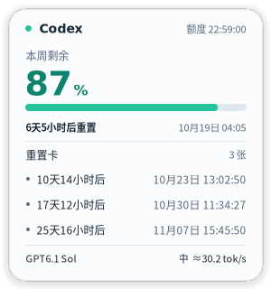
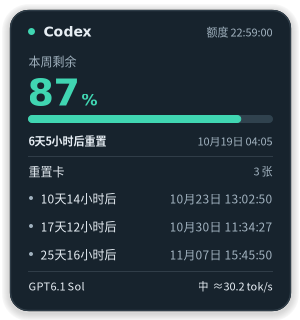

# CodexQuotaTray

一个轻量的 Windows 托盘工具，随时查看 Codex 剩余额度、重置时间和估算输出速度（TPS）。

[下载与版本](https://github.com/breakingtime126/CodexQuotaTray/releases) · [自动更新说明](docs/automatic-updates.md) · [问题反馈](https://github.com/breakingtime126/CodexQuotaTray/issues)

## 界面预览

  
  

*界面示例（演示数据）*

## 主要功能

- **额度一眼可见**：托盘数字与悬停卡显示剩余额度、账号重置时间和重置卡到期时间。
- **多种数据来源**：支持 Codex CLI、VSCode 插件和 Desktop；默认自动选择，也可手动指定。
- **输出速度参考**：显示模型、推理档位和估算 tok/s；无新样本时保留并标记上次记录。
- **公共重置提醒**：可选显示第三方公告与预测，使用“约1小时内”等简短文字。
- **日常使用方便**：支持跟随系统／浅色／深色主题、开机启动、手动刷新和连接诊断。
- **工具自己更新**：从本仓库 GitHub Releases 下载、校验并安装后续版本。

## 下载与开始使用

> [下载最新版本](https://github.com/breakingtime126/CodexQuotaTray/releases/latest)：在版本附件中下载 `CodexQuotaTray.exe`。

**运行要求**

- Windows 10 1903+ 或 Windows 11，x64。
- .NET Framework 4.8；运行程序不需要安装 .NET 8 SDK。
- 已安装并登录 Codex CLI、官方 VSCode 插件或 Codex Desktop 中的至少一种。

**首次使用**

1. 在 Releases 的附件中下载 `CodexQuotaTray.exe`。
2. 放到当前用户可写的普通文件夹；升级旧版时先退出旧程序。
3. 双击运行即可，无需管理员权限。图标未显示时，查看任务栏的隐藏图标区域。
4. 将鼠标移到托盘图标上查看详情；右键可切换数据来源、主题和其他选项。

默认自动模式依次尝试 CLI → VSCode 插件 → Desktop，并优先沿用已成功的来源。
未能读取额度时，先确认对应 Codex 已登录，再打开右键菜单中的“查看连接诊断”。

## 自动更新

从 **0.2.34** 起提供自动更新。首次需要手动安装带更新器的版本，之后由工具自行完成更新，无需通过 ChatGPT，也不用每次重新转发 EXE。

- 默认开启；启动约 15 秒后检查，之后每 10 分钟检查一次。发现新版后自动下载、校验、安装并重启，无需额外点击确认。
- 右键“自动更新”可关闭，关闭状态会保留；“检查更新”可手动检查并更新。
- 更新包来自本仓库 Releases，校验通过后在原位置替换并重启；更新失败时保留或恢复旧版。
- 请保持程序目录可写，并以普通用户权限运行；以管理员身份运行时不会自动安装更新。
- 下载优先使用 PowerShell 7，也支持 Windows 自带的 PowerShell 5.1。
- 公司网络、终端策略或安全软件仍可能限制下载和运行，工具不会绕过这些限制。

更多细节见 [自动更新说明](docs/automatic-updates.md)。

## 公共重置信息说明

“上次重置”和“预计重置”来自 [Codex Resets](https://codex-resets.com/api/docs) 的公共公告或第三方预测，**不是当前账号实际重置时间，也不保证预测会发生**。

从 **0.2.36** 起，本机优先直接读取 Codex Resets；原站访问超时、失败或数据无效时，自动改从本仓库的 GitHub 镜像读取。两边都不可用或数据过期时隐藏公共提示，不影响额度、重置卡和 TPS。

GitHub 镜像计划每 10 分钟同步一次，但调度可能延迟；超过 60 分钟未成功同步的数据不会显示。

此附加功能仍需标准位置安装的 PowerShell 7.5+。没有有效预测时不显示“预计重置”；镜像与工具自动更新是两项独立功能。[镜像与数据来源说明](docs/reset-mirror.md)

## 开发与文档

源码构建需要 .NET SDK 8（C# 12）或兼容更新版；运行 `scripts/build-lightweight.ps1`（Windows）或 `scripts/build-lightweight.sh`。

- [输出速度的计算与含义](docs/OUTPUT-SPEED.md)
- [当前版本验证记录与已知限制](docs/VERIFY-0.2.35.md)
- [其他验证记录](docs/VERIFICATION.md)
- [性能说明](docs/PERFORMANCE.md)

## 许可与声明

本工具非 OpenAI 官方产品。主应用暂未指定统一的根级开源许可证；源码公开可见不代表授予任意再许可权。
第三方组件分别遵循其原有许可证，许可与署名见 [third_party](third_party/)、[native/quota-reader](native/quota-reader/) 及程序“关于／许可”。
